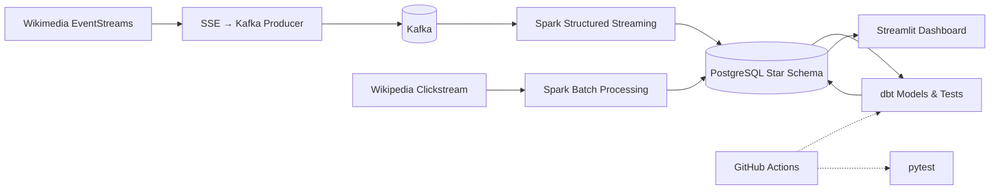

# Wikipedia Live Edit Pipeline

**Real-time + batch data platform for analyzing Wikipedia activity.**

This project combines Wikimedia's live edit stream with historical Clickstream data to build an end-to-end data platform. It ingests events through Kafka, processes streaming and batch workloads with Apache Spark, models data in PostgreSQL/dbt, and exposes results through a Streamlit dashboard.

## Why this project matters

The system demonstrates the full path from **ingestion → processing → modeling → storage → serving → validation**, rather than a single standalone ETL script.

## Architecture



## What it does

- Consumes live Wikipedia edit events from Wikimedia EventStreams.
- Publishes events to Kafka for decoupled downstream processing.
- Runs Spark Structured Streaming for short-window activity analysis.
- Loads historical Wikipedia Clickstream data with a Spark batch job.
- Stores curated data in PostgreSQL using a star-schema design.
- Uses dbt for transformations and data-quality tests.
- Provides a Streamlit dashboard for live and historical views.
- Runs automated pytest/dbt checks through GitHub Actions.

## Analytics implemented

- **Trending-page detection:** ranks pages by edit activity in minute-level windows.
- **Edit-velocity analysis:** uses `LAG()` to compare recent activity with prior periods.
- **Vandalism flagging:** identifies short bursts of anonymous editing activity followed by reverts.

## Data Engineering Stack

| Layer | Technology |
|---|---|
| Ingestion | Wikimedia EventStreams, Python |
| Messaging | Apache Kafka |
| Stream processing | Apache Spark Structured Streaming |
| Batch processing | Apache Spark |
| Storage | PostgreSQL 16 |
| Transformation & testing | dbt |
| Serving | Streamlit |
| Testing / CI | pytest, GitHub Actions |
| Local orchestration | Docker Compose, Make |

## Repository Structure

```text
.
├── ingestion/         # SSE consumer → Kafka producer
├── streaming/         # Spark Structured Streaming job
├── batch/             # Spark batch over Clickstream data
├── warehouse/         # PostgreSQL DDL + ER diagram
├── dbt/                # staging and mart models + tests
├── dashboard/          # Streamlit application
├── docs/report/         # Project documentation
├── tests/               # pytest tests
├── docker-compose.yml
├── Makefile
└── .env.example
```

## Quickstart

```bash
cp .env.example .env
make up
```

The local stack starts Kafka, PostgreSQL, the ingestion/streaming services, and the dashboard.

For the historical workload:

```bash
make download-clickstream
make batch
make dbt
make dbt-test
```

Then open the Streamlit dashboard at `http://localhost:8501`.

> The historical Clickstream download is large, so it is intentionally a separate one-time step rather than part of default startup.

## Engineering Notes

Streaming and batch workloads are intentionally separated while converging into the same analytical storage layer. This allows real-time signals and historical context to be analyzed together without coupling ingestion directly to the dashboard.

Docker Compose makes the multi-service environment reproducible locally, while GitHub Actions provides a basic quality gate for transformations and tests.

## Academic Context

Originally developed as a university Data Engineering final project. It is retained as a portfolio project because it demonstrates practical work across streaming systems, distributed processing, data modeling, testing, and application serving.
